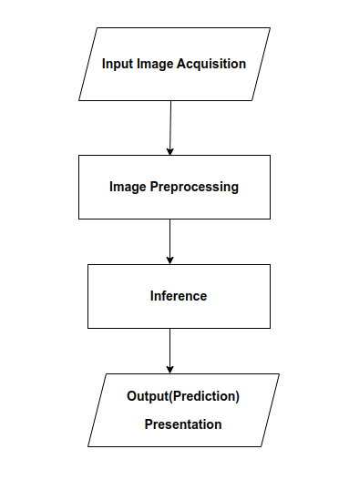
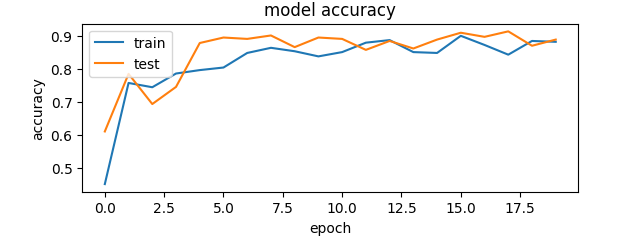
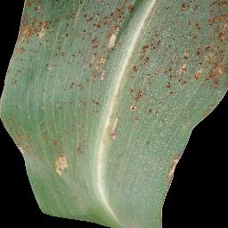

# Maize Disease Classification

Maize Disease Classification is a convolutional neural network (CNN) project for classifying maize leaf images. The project report describes the model as part of a mobile application workflow intended to help identify maize diseases from images.

## Classification categories

The model classifies images into four categories:

- Healthy
- Cercospora
- Common Rust
- Northern Leaf Blight

## Reported workflow

The workflow described in the report accepts an image captured with a device camera or selected from the image gallery, preprocesses it, runs model inference, and presents the predicted category with its probability. The report describes TensorFlow Lite as the framework for integrating the CNN into the mobile application.

## Model result

The report states that the model achieved 88% accuracy. Its training and validation accuracy graph is shown below.

## Sample leaf images

The following examples are from the report’s data sample appendix.

| Healthy | Cercospora | Common Rust | Northern Leaf Blight |
| --- | --- | --- | --- |
|  |  |  |  |

## Repository files

- `CNN/cnn.py` — CNN model and training script.
- `CNN/mdd.keras` — saved Keras model.
